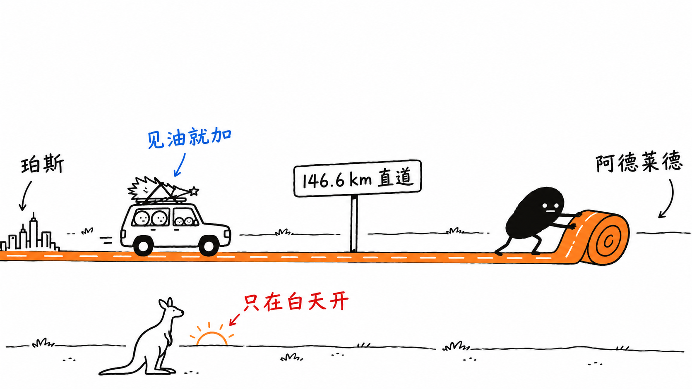

# 珀斯→阿德莱德 圣诞家庭自驾 草案

悉尼出发,飞到珀斯,一路沿南岸开车横穿 Nullarbor,平安夜、圣诞在路上过,12/31 赶到阿德莱德跨年。<strong>尚未预订任何东西</strong>,价格和班次都会变。

<b>12/12–1/3</b>23 天 22 晚

<b>4 人</b>2 大 2 小

<b>~3,560 km</b>自驾总里程

<b>372 km</b>单日最长

<h2 id="leave">请假安排</h2>

<b>12 天</b>合计请假

<b>5 天</b>bonus leave

<b>7 天</b>年假

<b>1/4 (一)</b>回去上班

<ul>
<li><strong>12/14–18(周一至周五)bonus leave 5 天</strong>:连续 5 个工作日,中间没有公众假期,单独一张申请。</li>
<li><strong>12/21–24、12/29–31 年假 7 天</strong>。</li>
<li>12/25 圣诞、12/28 节礼日补假(NSW,因为 12/26 是周六)、1/1 元旦都是公众假期,不用请。</li>
</ul>

<strong>孩子会缺课:</strong>NSW 公立学校 Term 4 最后上课日是 12/17(周四)。12/12 出发要缺 12/14–17 四天课;不想缺课可以改成 12/18 出发,压缩西澳南岸那段。

<h2 id="booking">预订顺序</h2>

请假批下来之后,按这个顺序订:

<ol class="steps">
<li><strong>先打电话订偏远小旅馆</strong>:Norseman、Caiguna、Eucla、Nullarbor Roadhouse,都要家庭房。圣诞周房少,这几家订不到,整条路线就不成立。</li>
<li><strong>机票</strong>(Google Flights,4 人含税,11/5 查)

<b>去程</b> 12/12 Virgin Australia 07:15 SYD → 09:20 PER,直飞,<strong>$1,784</strong> 备选 Jetstar 19:50 → 21:45,$1,449,到得太晚,不推荐

<b>回程</b> 1/3 Virgin Australia 19:55 ADL → 22:20 SYD,直飞,<strong>$700</strong>

托运行李可能另外收费。</li>
<li><strong>租车</strong>:12/15 Perth 机场取车 → 1/3 Adelaide 机场还车,共 19 天。4 个人 3 周的行李,要大号 SUV(Kluger / Santa Fe 级)。租金待查,异地还车费估计约 $1,300。</li>
<li><strong>其余住宿</strong>都订可以免费取消的。</li>
</ol>

<h2 id="days">每日路线</h2>

过夜点和每段里程(2026-11-05 Google 地图核实)。红框四站是偏远小旅馆,最先订。点图可放大。

<h3 class="phase">珀斯 · 前 3 天还没取车</h3>

12/12 六D1

飞抵 Perth

住 Perth

Kings Park 看城市日落

12/13 日D2

Rottnest Island 一日游(渡轮)

住 Perth

短尾矮袋鼠 quokka、骑车、浮潜

12/14 一D3

Perth / Fremantle

住 Perth

Fremantle 市场、海边炸鱼薯条

<h3 class="phase">西南角:Margaret River → Albany</h3>

12/15 二D4272 km

取车 → Margaret River

住 Margaret River

Busselton Jetty 栈桥小火车 + 海底观测站

12/16 三D5短途

Margaret River 周边

住 Margaret River

钟乳石洞 Mammoth/Lake Cave、海滩

12/17 四D6345 km

→ Albany(经 Denmark)

住 Albany

Greens Pool、Elephant Rocks

12/18 五D7短途

Albany

住 Albany

The Gap &amp; Natural Bridge

<h3 class="phase">南岸:Ravensthorpe → Norseman</h3>

12/19 六D8293 km

→ Ravensthorpe

住 Ravensthorpe

拆短路段

12/20 日D9187 km

→ Esperance

住 Esperance

Great Ocean Drive

12/21 一D10短途

Cape Le Grand 国家公园

住 Esperance

Lucky Bay 沙滩上的袋鼠

12/22 二D11203 km

→ Norseman

住 Norseman

进入 Nullarbor 前补给

<h3 class="phase">横穿 Nullarbor:平安夜和圣诞在路上</h3>

12/23 三D12372 km

→ Caiguna

住 Caiguna

146.6 km 全澳最长直道(90 Mile Straight)路牌

12/24 四D13337 km

→ Eucla(平安夜)

住 Eucla

沙丘中的老电报站遗址

12/25 五D14196 km

→ Nullarbor Roadhouse(圣诞)

住 Nullarbor RH

Bunda Cliffs 海崖;圣诞晚餐需提前订

12/26 六D15296 km

→ Ceduna

住 Ceduna

生蚝;入南澳检疫站(水果蔬菜没收)

<h3 class="phase">南澳海岸:Streaky Bay → Port Augusta</h3>

12/27 日D16109 km

→ Streaky Bay

住 Streaky Bay

Murphy&#x27;s Haystacks 怪石

12/28 一D17295 km

→ Port Lincoln

住 Port Lincoln

海港小城

12/29 二D18短途

Coffin Bay

住 Port Lincoln

生蚝 / 海狮共游团

12/30 三D19342 km

→ Port Augusta

住 Port Augusta

Flinders Ranges 门户

<h3 class="phase">阿德莱德:跨年,收尾</h3>

12/31 四D20309 km

→ Adelaide(跨年)

住 Adelaide

Elder Park 跨年,21:30 家庭早场烟花

1/1 五D21

Adelaide

住 Adelaide

Glenelg 海滩 + 有轨电车

1/2 六D22短途

Adelaide Hills

住 Adelaide

Hahndorf 德国村、Cleland 野生动物园抱考拉

1/3 日D23

还车,19:55 飞回悉尼

<h2 id="budget">预算</h2>

粗估,不含餐饮,单位 AUD。

机票

$2,484

实查(去 $1,784 + 回 $700)

住宿 22 晚

$5,000–7,000

家庭房 $200–350/晚

油费

$800–1,000

偏远地区油价高

租车

待查

大号 SUV + 异地还车费约 $1,300

不含租车合计

约 $8,300–10,500

<h2 id="tips">路上须知</h2>

<ul class="tips">
<li><strong>只在白天开车。</strong>黄昏到清晨袋鼠多;租车合同里偏远地区夜间行驶的条款要看清楚。</li>
<li><strong>进南澳有检疫站</strong>(Ceduna 附近),水果蔬菜会被没收,之前别囤。</li>
<li><strong>往东开,时钟一路往前拨</strong>,累计约 2.5 小时:西澳 +8 → 中部 +8:45 → 南澳夏令时 +10:30。</li>
<li><strong>Nullarbor 段加油站之间可能隔 200 km</strong>,见油就加。</li>
<li><strong>带足饮用水和零食。</strong>偏远段手机信号时有时无,提前下载离线地图。</li>
</ul>

草案,尚未预订。距离 2026-11-05 用 Google 地图核实;价格为 AUD,2026-11-05 实查或估算,会浮动。

