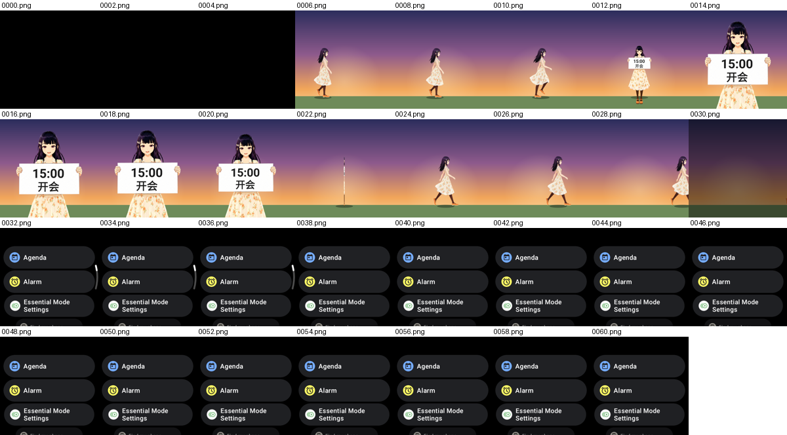

# 魔方 R-3「散步小女孩提醒」v1

TicWatch Pro 3（「魔方」）上的独立小应用 `today.yan.cubepda`：到点震一下，散步小女孩从屏幕边走进来，举牌显示事项，看完走开。事项只存手表本机 SQLite，不上云。

## 视频

**1. 动画（App 里同一套 Canvas 代码逐帧渲染，30fps，13 秒）**

<video src="r3_demo.mp4" controls playsinline muted loop width="454"></video>

**2. 真机实录（手表 screencap 连拍，约 2.6fps，所以看起来一顿一顿；用来证明真的在表上跑通）**

<video src="r3_device.mp4" controls playsinline muted width="454"></video>

说明：真机截屏看起来像转了方向，是因为这块表的系统显示整体转了 90°（按钮朝上戴），屏幕上看是正的。视频里看不到震动，震动以系统日志为证。

## v1 做了什么
- 到点提醒：熄屏状态下也会准时亮屏（实测误差 18–26 毫秒），先震 200ms，再播放动画。
- 动画：小女孩侧面走入 → 纸片翻转转身 → 正面举牌（牌上大字，如「15:00 开会」）→ 停几秒 → 转身走出 → 回到之前的界面。
- 存储：本机 SQLite，不联网。
- 重启不丢：排好的提醒在手表重启后会自动重排，仍按时触发。
- 不干扰手表原有功能（语音输入、表盘、系统桌面都没动）。

## v1 不做什么
- 手表上还没有「添加事项」的界面：目前只能用测试按钮「+ 测试提醒（10 秒后）」或调试命令添加。
- 不做翻面完成 / 敲击稍后、出门同步、购物清单勾选（以后的版本再议）。

## 怎么验收（跑过的 V1–V8，全部通过）
1. 构建成功，APK 约 540 KB。
2. 安装后表盘、语音服务、系统桌面都没变。
3. 加一条事项，数据库里能查到这一行。
4. 熄屏排 25 秒后的提醒 → 准时触发（晚 26ms），系统震动记录里有本应用 200ms 震动，前台是提醒界面。
5. 动画逐帧评审 7 轮：走入、举牌、文字清楚不被圆屏裁、走开、回到原界面。
6. 熄屏场景能亮屏播放。
7. 排 3 分钟后的提醒 → 重启手表 → 开机后照样准时触发（晚 18ms）。
8. 测试数据清掉，表恢复熄屏，原有功能正常。

已知注意点：需要给本应用「在其他应用上层显示」权限（已授权，重装不丢；恢复出厂要重新授权）。

## 欢迎挑刺
小女孩走路节奏、举牌停留时长、字号、震动强弱……有意见继续提，进 v2。
